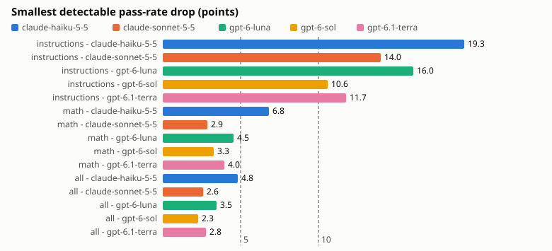
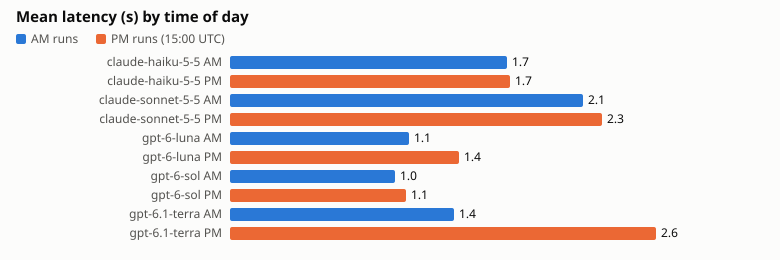

# Noise report (W3.1)

- Generated: 2026-11-19 19:31 UTC by `python -m scripts.noise_report`, repo commit `c6033ab`.
- Burst (`mpt_burst.db`): 2026-11-17 16:39 to 2026-11-17 19:43 UTC (3 h 4 min). 5 models x 68 probes x 20 repeats, fired back to back.
- Scheduled (`mpt.db`): runs 1-11, 2026-11-14 02:32 to 2026-11-18 15:41 UTC (109 h 9 min). Scheduled split, no Opus, 3 repeats per probe per run.
- Window = 12 repeats per probe (4 runs). Pass-rate values are points. Plan target: 1 false alarm in 500 checks.
- **Canonical method:** the false-alarm threshold is the empirical 99.8th percentile of |window 2 - window 1| over 20,000 random stratified burst splits (each probe's repeats shuffled, 10 per window, so both windows hold the same probes), scaled to 12 repeats by sqrt(10/12). The normal approximation (3.09 x std) is shown beside it for comparison only; the two differ most for the 10-probe categories (higher for some, lower for others), where the tails are heavy or lumpy; where the normal figure is lower, using it would give more than 1 false alarm in 500. Output-length thresholds in section 4 are still the normal approximation (provisional). Latency is not thresholded (section 4).

## 1. Pass-rate noise floor per provider, model, category

`std` = noise of the difference between two windows; `99.8% empirical` = the false-alarm threshold (canonical); `3.09 x std` = normal approximation, for comparison; `MDS` = minimum detectable shift at 80% power (empirical threshold + 0.84 x std); `run ratio` = real run-to-run sd / burst-predicted sd (above about 1.35 = runs vary more than the burst predicts). `no noise` = every probe gives the same result each time.

| provider | model | category | probes | pass % | std | 99.8% empirical | 3.09 x std | MDS | run ratio |
|---|---|---|---|---|---|---|---|---|---|
| anthropic | claude-haiku-5-5 | coding | 12 | 100.0 | 0.00 | 0.00 | 0.00 | no noise | n/a |
| anthropic | claude-haiku-5-5 | instructions | 10 | 67.4 | 4.15 | 15.83 | 12.81 | 19.32 | 0.95 |
| anthropic | claude-haiku-5-5 | math | 36 | 69.6 | 1.77 | 5.33 | 5.46 | 6.81 | 0.97 |
| anthropic | claude-haiku-5-5 | structured | 10 | 100.0 | 0.00 | 0.00 | 0.00 | no noise | n/a |
| anthropic | claude-haiku-5-5 | all | 68 | 79.2 | 1.11 | 3.85 | 3.43 | 4.79 | 0.72 |
| anthropic | claude-sonnet-5-5 | coding | 12 | 100.0 | 0.00 | 0.00 | 0.00 | no noise | n/a |
| anthropic | claude-sonnet-5-5 | instructions | 10 | 85.0 | 3.60 | 10.95 | 11.13 | 13.99 | 1.66 |
| anthropic | claude-sonnet-5-5 | math | 36 | 4.3 | 0.70 | 2.28 | 2.17 | 2.87 | 0.84 |
| anthropic | claude-sonnet-5-5 | structured | 10 | 99.0 | 1.26 | 1.83 | 3.91 | 2.89 | 0.88 |
| anthropic | claude-sonnet-5-5 | all | 68 | 47.0 | 0.68 | 2.01 | 2.09 | 2.58 | 1.62 |
| openai | gpt-6-luna | coding | 12 | 100.0 | 0.00 | 0.00 | 0.00 | no noise | n/a |
| openai | gpt-6-luna | instructions | 10 | 51.8 | 4.13 | 12.56 | 12.77 | 16.04 | 0.91 |
| openai | gpt-6-luna | math | 36 | 69.7 | 1.17 | 3.55 | 3.61 | 4.53 | 1.13 |
| openai | gpt-6-luna | structured | 10 | 90.0 | 0.00 | 0.00 | 0.00 | no noise | n/a |
| openai | gpt-6-luna | all | 68 | 75.5 | 0.86 | 2.73 | 2.67 | 3.45 | 0.77 |
| openai | gpt-6-sol | coding | 12 | 100.0 | 0.00 | 0.00 | 0.00 | no noise | n/a |
| openai | gpt-6-sol | instructions | 10 | 60.5 | 2.80 | 8.22 | 8.64 | 10.57 | 1.08 |
| openai | gpt-6-sol | math | 36 | 79.4 | 0.88 | 2.54 | 2.72 | 3.28 | 1.07 |
| openai | gpt-6-sol | structured | 10 | 100.0 | 0.00 | 0.00 | 0.00 | no noise | n/a |
| openai | gpt-6-sol | all | 68 | 83.3 | 0.62 | 1.75 | 1.92 | 2.27 | 1.20 |
| openai | gpt-6.1-terra | coding | 12 | 100.0 | 0.00 | 0.00 | 0.00 | no noise | n/a |
| openai | gpt-6.1-terra | instructions | 10 | 48.0 | 3.11 | 9.13 | 9.61 | 11.75 | 1.35 |
| openai | gpt-6.1-terra | math | 36 | 81.1 | 1.08 | 3.04 | 3.35 | 3.96 | 1.03 |
| openai | gpt-6.1-terra | structured | 10 | 100.0 | 0.00 | 0.00 | 0.00 | no noise | n/a |
| openai | gpt-6.1-terra | all | 68 | 82.4 | 0.74 | 2.15 | 2.27 | 2.77 | 1.30 |



## 2. Runs per window to detect a 5-point and a 10-point drop

```text
MDS(r) = MDS12 * sqrt(12 / r)        MDS12 = empirical 99.8% threshold + 0.84 * std for a 12-repeat window (section 1)
r      = 12 * (MDS12 / d)^2          repeats per probe per window needed to detect a drop of d points
runs   = ceil(r / 3)                 3 repeats per probe per run; 2 runs a day; same count for reference and current window
```

| model | category | probes | 5 pt: runs (days) | 10 pt: runs (days) |
|---|---|---|---|---|
| claude-haiku-5-5 | coding | 12 | no noise | no noise |
| claude-haiku-5-5 | instructions | 10 | 60 (30.0 d) | 15 (7.5 d) |
| claude-haiku-5-5 | math | 36 | 8 (4.0 d) | 2 (1.0 d) |
| claude-haiku-5-5 | structured | 10 | no noise | no noise |
| claude-haiku-5-5 | all | 68 | 4 (2.0 d) | 1 (0.5 d) |
| claude-sonnet-5-5 | coding | 12 | no noise | no noise |
| claude-sonnet-5-5 | instructions | 10 | 32 (16.0 d) | 8 (4.0 d) |
| claude-sonnet-5-5 | math | 36 | impossible | impossible |
| claude-sonnet-5-5 | structured | 10 | 2 (1.0 d) | 1 (0.5 d) |
| claude-sonnet-5-5 | all | 68 | 2 (1.0 d) | 1 (0.5 d) |
| gpt-6-luna | coding | 12 | no noise | no noise |
| gpt-6-luna | instructions | 10 | 42 (21.0 d) | 11 (5.5 d) |
| gpt-6-luna | math | 36 | 4 (2.0 d) | 1 (0.5 d) |
| gpt-6-luna | structured | 10 | no noise | no noise |
| gpt-6-luna | all | 68 | 2 (1.0 d) | 1 (0.5 d) |
| gpt-6-sol | coding | 12 | no noise | no noise |
| gpt-6-sol | instructions | 10 | 18 (9.0 d) | 5 (2.5 d) |
| gpt-6-sol | math | 36 | 2 (1.0 d) | 1 (0.5 d) |
| gpt-6-sol | structured | 10 | no noise | no noise |
| gpt-6-sol | all | 68 | 1 (0.5 d) | 1 (0.5 d) |
| gpt-6.1-terra | coding | 12 | no noise | no noise |
| gpt-6.1-terra | instructions | 10 | 23 (11.5 d) | 6 (3.0 d) |
| gpt-6.1-terra | math | 36 | 3 (1.5 d) | 1 (0.5 d) |
| gpt-6.1-terra | structured | 10 | no noise | no noise |
| gpt-6.1-terra | all | 68 | 2 (1.0 d) | 1 (0.5 d) |

## 3. Identical-text rate

Share of pairs of repeats (same model, same probe) with exactly the same text.

| model | burst (20 repeats) | scheduled, within a run (3 repeats) |
|---|---|---|
| claude-haiku-5-5 | 63% | 63% |
| claude-sonnet-5-5 | 36% | 36% |
| gpt-6-luna | 74% | 75% |
| gpt-6-sol | 83% | 88% |
| gpt-6.1-terra | 75% | 81% |

## 4. Latency and output length: burst vs scheduled runs

`burst sd` = predicted sd of one run's mean (3 repeats per probe, calls treated as independent); `run sd` = actual sd across the scheduled runs; `ratio` above about 1.35 = runs vary more than the burst predicts. `threshold` = false-alarm threshold for a 12-repeat window: empirical for pass rate (section 1), normal approximation for output tokens (provisional).

**Latency cannot be thresholded from the burst.** Real run-to-run latency spread is 2.4x to 33.4x the burst prediction (largest: gpt-6.1-terra). Provider load drives day-to-day latency, and the burst's back-to-back calls flatter it. Latency needs its own baseline from the scheduled runs.

| model | metric | burst mean | scheduled mean | threshold | burst sd | run sd | ratio |
|---|---|---|---|---|---|---|---|
| claude-haiku-5-5 | pass rate (pts) | 79.16 | 78.46 | 3.851 | 1.579 | 1.141 | 0.72 |
| claude-haiku-5-5 | latency (s) | 1.59 | 1.69 | not usable | 0.038 | 0.095 | 2.49 |
| claude-haiku-5-5 | output tokens | 270.98 | 255.80 | 18.658 (provisional) | 8.539 | 9.224 | 1.08 |
| claude-sonnet-5-5 | pass rate (pts) | 46.99 | 46.12 | 2.014 | 0.953 | 1.542 | 1.62 |
| claude-sonnet-5-5 | latency (s) | 2.01 | 2.20 | not usable | 0.026 | 0.164 | 6.36 |
| claude-sonnet-5-5 | output tokens | 184.95 | 185.92 | 6.676 (provisional) | 3.055 | 4.227 | 1.38 |
| gpt-6-luna | pass rate (pts) | 75.46 | 75.37 | 2.726 | 1.226 | 0.943 | 0.77 |
| gpt-6-luna | latency (s) | 1.30 | 1.22 | not usable | 0.088 | 0.209 | 2.38 |
| gpt-6-luna | output tokens | 35.13 | 31.75 | 27.534 (provisional) | 12.601 | 9.360 | 0.74 |
| gpt-6-sol | pass rate (pts) | 83.31 | 84.63 | 1.745 | 0.883 | 1.058 | 1.20 |
| gpt-6-sol | latency (s) | 1.14 | 1.03 | not usable | 0.023 | 0.067 | 2.87 |
| gpt-6-sol | output tokens | 25.34 | 25.29 | 0.223 (provisional) | 0.102 | 0.088 | 0.87 |
| gpt-6.1-terra | pass rate (pts) | 82.35 | 82.35 | 2.148 | 1.042 | 1.351 | 1.30 |
| gpt-6.1-terra | latency (s) | 2.06 | 1.92 | not usable | 0.039 | 1.287 | 33.39 |
| gpt-6.1-terra | output tokens | 24.89 | 24.86 | 0.262 (provisional) | 0.120 | 0.178 | 1.48 |

## 5. Time of day

AM = runs started before 12:00 UTC (1, 2, 4, 6, 8, 10); PM = 15:00 UTC runs (3, 5, 7, 9, 11). `p` = exact permutation test over which runs are PM; `p x 15` = p multiplied by the number of tests in this table (capped at 1).

| model | metric | AM mean | PM mean | PM - AM | p | p x 15 |
|---|---|---|---|---|---|---|
| claude-haiku-5-5 | pass rate (pts) | 78.397 | 78.529 | +0.133 | 0.835 | 1.000 |
| claude-haiku-5-5 | latency (s) | 1.683 | 1.700 | +0.018 | 0.760 | 1.000 |
| claude-haiku-5-5 | output tokens | 253.361 | 258.718 | +5.357 | 0.353 | 1.000 |
| claude-sonnet-5-5 | pass rate (pts) | 45.833 | 46.471 | +0.637 | 0.526 | 1.000 |
| claude-sonnet-5-5 | latency (s) | 2.142 | 2.259 | +0.118 | 0.279 | 1.000 |
| claude-sonnet-5-5 | output tokens | 185.587 | 186.315 | +0.728 | 0.779 | 1.000 |
| gpt-6-luna | pass rate (pts) | 75.327 | 75.418 | +0.091 | 0.883 | 1.000 |
| gpt-6-luna | latency (s) | 1.086 | 1.390 | +0.304 | 0.004 | 0.065 |
| gpt-6-luna | output tokens | 26.252 | 38.346 | +12.094 | 0.013 | 0.195 |
| gpt-6-sol | pass rate (pts) | 84.886 | 84.314 | -0.572 | 0.418 | 1.000 |
| gpt-6-sol | latency (s) | 1.003 | 1.066 | +0.064 | 0.126 | 1.000 |
| gpt-6-sol | output tokens | 25.289 | 25.287 | -0.002 | 0.987 | 1.000 |
| gpt-6.1-terra | pass rate (pts) | 82.761 | 81.863 | -0.899 | 0.348 | 1.000 |
| gpt-6.1-terra | latency (s) | 1.363 | 2.585 | +1.223 | 0.026 | 0.390 |
| gpt-6.1-terra | output tokens | 24.817 | 24.910 | +0.093 | 0.429 | 1.000 |

**Suggestive, not confirmed.** PM is higher with raw p < 0.05 for: gpt-6-luna latency (s) (p = 0.004); gpt-6-luna output tokens (p = 0.013); gpt-6.1-terra latency (s) (p = 0.026). With 15 tests the smallest adjusted p is 0.06. Read it as a possible PM slowdown for gpt-6-luna, gpt-6.1-terra; it needs more runs.

Mean latency of each run (s), to see which runs drive the slot differences:

| run | slot | claude-haiku-5-5 | claude-sonnet-5-5 | gpt-6-luna | gpt-6-sol | gpt-6.1-terra |
|---|---|---|---|---|---|---|
| 1 | AM | 1.75 | 2.14 | 1.10 | 0.96 | 1.22 |
| 2 | AM | 1.69 | 2.14 | 1.06 | 1.01 | 1.22 |
| 3 | PM | 1.81 | 2.44 | 1.22 | 1.00 | 1.39 |
| 4 | AM | 1.71 | 2.15 | 1.07 | 0.96 | 1.28 |
| 5 | PM | 1.77 | 2.55 | 1.15 | 0.97 | 1.38 |
| 6 | AM | 1.84 | 2.26 | 1.17 | 1.02 | 1.38 |
| 7 | PM | 1.63 | 1.99 | 1.62 | 1.12 | 1.76 |
| 8 | AM | 1.56 | 2.06 | 1.04 | 1.02 | 1.46 |
| 9 | PM | 1.66 | 2.10 | 1.40 | 1.07 | 2.86 |
| 10 | AM | 1.55 | 2.11 | 1.07 | 1.05 | 1.62 |
| 11 | PM | 1.64 | 2.22 | 1.57 | 1.17 | 5.54 |

Runs slower than 1.5x the model's median run: claude-haiku-5-5: none; claude-sonnet-5-5: none; gpt-6-luna: none; gpt-6-sol: none; gpt-6.1-terra: 9, 11.

Without those runs, PM - AM mean latency: gpt-6.1-terra +0.15 s.



## Notes (read before using the numbers)

1. **Latency is not thresholded from the burst** (section 4). It needs its own scheduled-data baseline.
2. **Math pass rates mostly measure answer format, not maths.** The prompts say to reply with only the number. The scorer (`numeric_match`) requires the whole reply to parse as one number, so a reply that shows working and ends with the answer scores 0 even if the final value is correct. Sonnet's math pass rate is 4.3%; in `docs/noise_findings.md` all 5 samples checked had a correct final value. Share of each model's failed math calls whose reply was not a valid number: claude-haiku-5-5 99.5% of 219; claude-sonnet-5-5 100.0% of 689; gpt-6-luna 0.0% of 218; gpt-6-sol 0.0% of 148; gpt-6.1-terra 0.0% of 136. Sonnet's overall pass rate, its extra run-to-run variation and its possible trend should be read as format-compliance behaviour.
3. **Scoring is strict.** The scorers are not loosened to forgive format, so a model that drifts away from the requested format shows up as a pass-rate change (which the monitor should see) and format compliance is part of every pass rate.
4. **The burst is one window** (see its span in the header), so its noise is a lower bound on real noise.
5. **Pinning:** Claude model IDs are documented as pinned; OpenAI lists no dated snapshots for these models, so their pinning is unknown. The burst assumes no model change inside its window.
6. **Categories with no noise** (coding, structured, whenever the table says `no noise`) have no usable threshold, and the permutation method gives none. They need a different alarm rule (for example alarm on any new failure). No such rule exists yet.
7. **Monte Carlo error:** an empirical 99.8% threshold rests on about 40 of the 20,000 splits lying beyond it, so the 10-probe categories carry an error of a couple of points (haiku instructions came out at 13.9 in an earlier run and 15.8 here). Report them as approximate.
8. **Many tests:** 15 time-of-day tests, 5 models x 5 categories of floors and several ratios. A 1-in-500 threshold applies per check, not overall. The many-tests correction for the detectors is still open in the plan.
